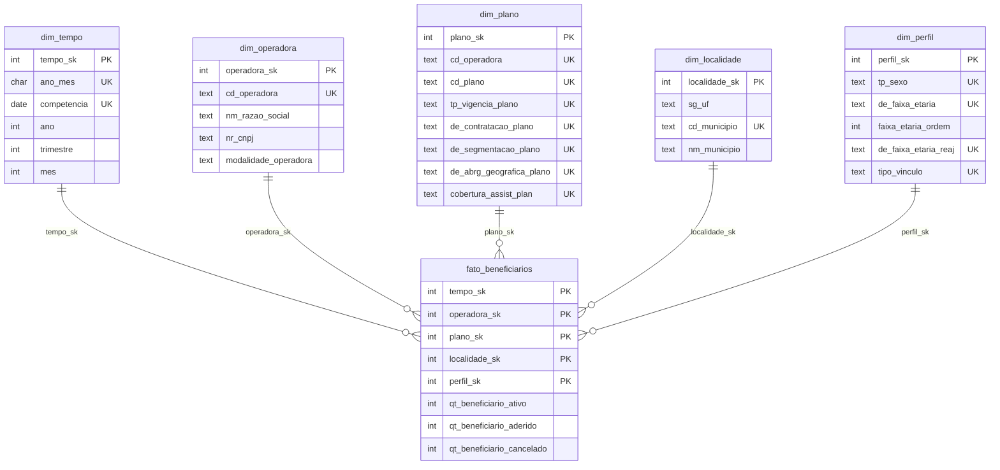
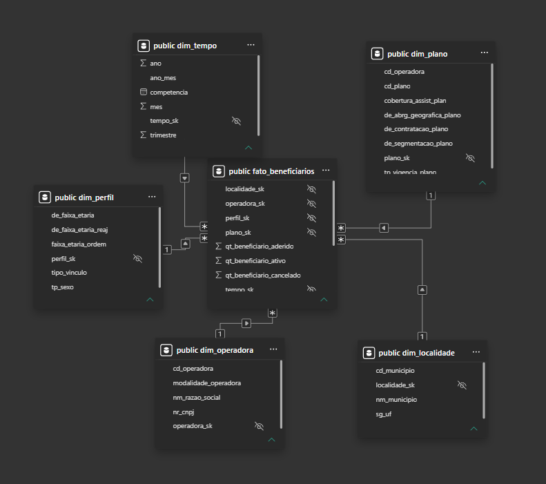

# ANS Beneficiários: Data Warehouse (Espírito Santo)

Data warehouse em modelo estrela com os beneficiários de planos de saúde do ES, a partir dos dados abertos da ANS. O banco roda em PostgreSQL dentro do Docker, a carga é feita em Python e SQL, e o consumo é feito no Power BI.

**Stack:** PostgreSQL 16 (Docker Compose) · Python 3 (requests, psycopg 3, python-dotenv) · SQL · Power BI · Git

## Granularidade

Cada linha de `fato_beneficiarios` representa as quantidades de beneficiários (ativos, aderidos e cancelados) de uma competência, em um plano de uma operadora, em um município, para um perfil (sexo, faixa etária, faixa etária de reajuste e tipo de vínculo).

## Arquitetura

```
ANS (dados abertos)  ->  extract.py  ->  data/raw/AAAAMM/*.csv
                                              |
                                   load_staging.py (COPY)
                                              v
                                    stg_beneficiarios  (bronze, tudo TEXT)
                                              |
                          sql/02_dimensoes.sql + sql/03_fato.sql
                                              v
                  dim_tempo, dim_operadora, dim_plano, dim_localidade, dim_perfil
                                  + fato_beneficiarios  (modelo estrela)
                                              |
                                      sql/04_qualidade.sql
                                              |
                                  sql/consultas.sql  /  Power BI
```

## Modelo estrela



Toda dimensão tem chave substituta (`*_sk`, `GENERATED ALWAYS AS IDENTITY`) e chave natural única (`UK`). A fato tem chave primária composta pelas 5 chaves, o que impõe a granularidade no próprio banco, e índices nas chaves estrangeiras.

## Decisões de modelagem

- **Códigos como texto.** `cd_operadora`, `cd_plano` e `cd_municipio` são identificadores, não números: preservam zeros à esquerda e não entram em contas.
- **Plano identificado por mais de um campo.** O `cd_plano` sozinho não é único. O plano é identificado por operadora + código + 5 atributos (vigência, contratação, segmentação, abrangência e cobertura).
- **Valores sentinela mantidos como membros da dimensão.** Valores como "Município ignorado - ES" (código 320000), "Não Identificado" e "Informada Incorreta" não são descartados: representam dados reais que a ANS publica. Ficam visíveis e filtráveis.
- **`faixa_etaria_ordem`.** Coluna numérica que ordena as faixas etárias (ordenar o texto poria "10 a 14" antes de "1 a 4"). Faixas desconhecidas caem em 99, e o `04_qualidade.sql` acusa qualquer faixa nova.
- **`dim_tempo` gerada, não derivada.** Criada com `generate_series` (2021-05 a 2030-12, 116 meses), independente das competências carregadas.
- **`dim_operadora` guarda só a versão mais recente** de razão social e modalidade (`DISTINCT ON` pela competência mais recente). Nas 3 competências carregadas, nenhuma operadora mudou. Registrar histórico (SCD tipo 2) ficou como evolução.
- **Medidas: ativos é um retrato do mês, aderidos e cancelados são movimentos.** Beneficiários ativos **não se somam entre competências**. No Power BI, a medida `Ativos` usa o último mês do contexto de filtro. `Aderidos` e `Cancelados` somam normalmente.

## Carga repetível (idempotente)

- **Staging:** antes de carregar um arquivo, apaga as linhas daquele `arquivo_origem` (tudo dentro de uma transação).
- **Dimensões:** `INSERT ... ON CONFLICT DO NOTHING`.
- **Fato:** em uma transação, apaga as competências presentes no staging e reinsere.
- Resultado: recarregar a mesma competência duas vezes não duplica nada, o que é verificado pelo `04_qualidade.sql`.

## Como rodar do zero

Pré-requisitos: Docker Desktop, Python 3.11+ e Git.

```powershell
# 1. Configuração
Copy-Item .env.example .env        # edite o .env e troque a senha

# 2. Banco (o schema sql/01_schema.sql é criado na primeira subida)
docker compose up -d
docker compose ps                  # aguarde o status "healthy"

# 3. Ambiente Python
python -m venv .venv
.venv\Scripts\Activate.ps1
pip install -r requirements.txt

# 4. Pipeline: extração, staging, dimensões e fato
python src\main.py

# 5. Qualidade e consultas
Get-Content sql\04_qualidade.sql | docker compose exec -T db psql -U ans -d ans_dw -v ON_ERROR_STOP=1
Get-Content sql\consultas.sql    | docker compose exec -T db psql -U ans -d ans_dw -v ON_ERROR_STOP=1
```

Os dados persistem no volume `pgdata`: `docker compose down` mantém o banco, e `docker compose down -v` apaga tudo. Os segredos ficam apenas no `.env`, que não é versionado.

## Estrutura do repositório

```
.
|-- docker-compose.yml
|-- .env.example
|-- requirements.txt
|-- src/
|   |-- extract.py         # baixa e extrai o ZIP da ANS
|   |-- db.py              # conexão com o PostgreSQL
|   |-- load_staging.py    # COPY do CSV para o staging
|   `-- main.py            # orquestra o pipeline
|-- sql/
|   |-- 01_schema.sql      # tabelas, chaves e índices
|   |-- 02_dimensoes.sql   # carga das dimensões
|   |-- 03_fato.sql        # carga da fato
|   |-- 04_qualidade.sql   # verificações de qualidade
|   `-- consultas.sql      # 7 perguntas de negócio
`-- docs/
    |-- modelo.png
    `-- powerbi.png
```

## Qualidade dos dados

O `sql/04_qualidade.sql` roda após cada carga e confere:

- linhas e somas das medidas, staging x fato, por competência;
- chaves órfãs (linhas do staging sem dimensão correspondente);
- dimensões sem uso na fato e operadora da fato diferente da operadora do plano;
- faixas etárias novas (ordem 99 além de "Informada Incorreta");
- medidas negativas.

## Resultados (ES, competências 2026-06, 2026-07 e 2026-08)

| Competência | Linhas na fato | Ativos | Aderidos | Cancelados |
|---|---|---|---|---|
| 2026-06 | 413.803 | 2.364.871 | 82.831 | 73.325 |
| 2026-07 | 414.742 | 2.372.730 | 84.572 | 76.713 |
| 2026-08 | 414.970 | 2.384.129 | 81.037 | 69.638 |

Total: 1.243.515 linhas, 426 operadoras e 79 localidades. O modelo ainda tem 127 perfis e 116 meses na dimensão de tempo.

Algumas respostas das consultas (`sql/consultas.sql`), na competência mais recente:

- A SAMP lidera com 871.287 ativos, cerca de 36,5% do estado, seguida pela Unimed Vitória (397.488).
- Medicina de Grupo concentra 58,1% dos ativos e as cooperativas médicas, 27,1%.
- A SAMP lidera na maioria dos municípios, e as Unimeds regionais lideram no interior do estado.
- Os ativos cresceram 7.859 de junho para julho e 11.399 de julho para agosto.

## Consumo no Power BI

O relatório conecta-se ao PostgreSQL (`localhost:5432`, banco `ans_dw`) em modo Importar, com as 5 relações da fato para as dimensões e as chaves `*_sk` ocultas. As medidas (`Ativos`, `Aderidos`, `Cancelados`, `Saldo de Adesões`, `Participação %`) ficam na tabela de fatos.




O arquivo `.pbix` não é versionado, por conter os dados importados.

## Limitações e próximos passos

- Apenas a UF ES; a extração já é parametrizada por UF e competência.
- Histórico de operadoras (SCD tipo 2) não implementado.
- A extração baixa o ZIP a cada execução; poderia reaproveitar arquivos já baixados.
- Sem orquestração agendada; o `main.py` é executado manualmente.